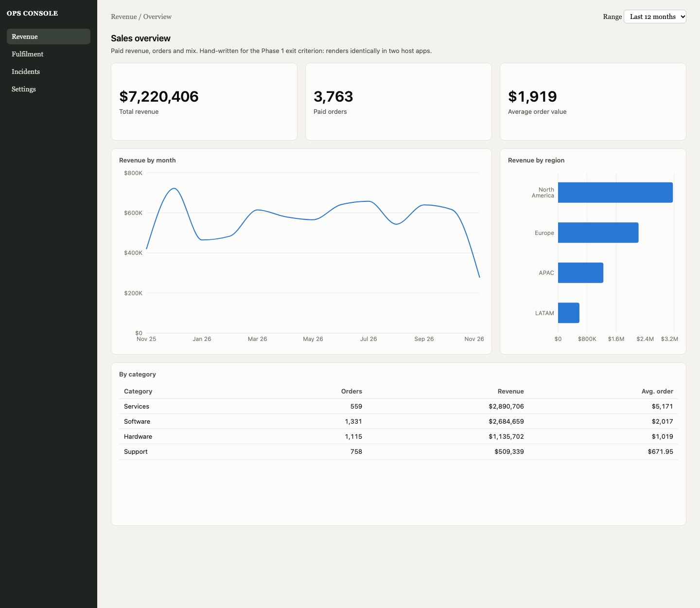
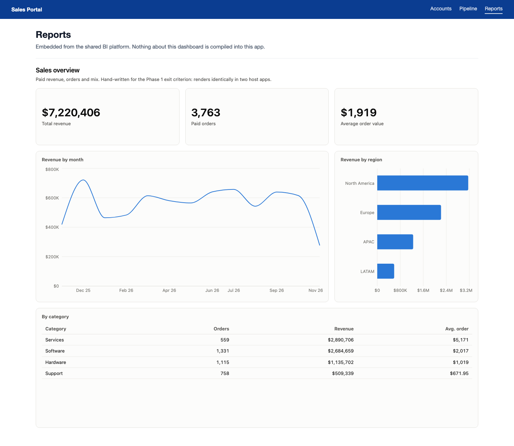

# Sratchpad

Self-service BI for developers. Build a dashboard by dragging widgets onto a canvas, or attach a
CSV/Excel file or a Snowflake table and get an AI-suggested starter dashboard. Every dashboard is a
versioned JSON document that renders plug-and-play inside any team's React app, can be read by other
applications, and can be shared read-only with business users. One shared backend serves every team.

| Ops Console (a team's app) | Sales Portal (another team's app) |
| --- | --- |
|  |  |

## Documentation

| Doc | What's in it |
| --- | --- |
| [Architecture](docs/ARCHITECTURE.md) | Components, request flows, storage, security model, scaling, current limits |
| [Decisions](docs/DECISIONS.md) | Every decision made building Sratchpad, why, the alternatives, and open questions |
| [User guide](docs/GUIDE.md) | Building, suggesting and sharing dashboards |
| [API](docs/API.md) | Routes, roles, share tokens, embedding, reading the JSON from your app |
| [Spec](docs/SPEC.md) | The dashboard JSON contract, styling, versioning rules and query semantics |
| [Capabilities](docs/CAPABILITIES.md) | What you can build, what Tableau/Qlik can do that Sratchpad can't yet, and the roadmap |
| [Deployment](docs/DEPLOYMENT.md) | AWS ECS + Snowflake setup, image, smoke test, full configuration reference |
| [Changelog](docs/CHANGELOG.md) | What changed, when, and what is not yet verified |
| [Original design](docs/design-doc.md) | The proposal Sratchpad was built from (historical) |

## Status

| Phase | Proves | Built |
| --- | --- | --- |
| 1 · The contract renders | Hand-written JSON renders identically in two host apps | Spec v1.1, renderer SDK, versioned store |
| 2 · Real data, pushed down | Live aggregates from a 1M-row file without slowing the browser | Uploads, Snowflake pushdown, profiler, draft preview |
| 3 · Drag-and-drop authoring | A developer builds and embeds a dashboard with no code | The Studio |
| 4 · AI recommendations | Attach data, get an editable starter dashboard | Rule-built candidates + Claude ranking |
| 5 · Harden & scale | Safe for every team on one backend | Cache, per-team limits, metrics, logs, roles, sharing, ECS image, Snowflake-only storage |
| Beyond | Build by talking; full control of the look | Studio chat assistant; spec 1.2 styling (themes, colors, labels, axes) |
| Spec 1.3 | Close the Tableau/Qlik gaps | Calculations, interactivity, row-level security, 11 new chart types, formatting, exports, subscriptions, alerts, comments, metric catalog ([capabilities](docs/CAPABILITIES.md)) |

**Not yet verified against live services:** the Snowflake paths (hybrid-table store, Iceberg uploads,
query engine incl. 1.3 SQL), the Claude ranker and assistant, and email/webhook delivery are tested with fakes
and adapters. Run the
[first-deploy smoke test](docs/DEPLOYMENT.md#5-first-deploy-smoke-test-do-this-on-a-non-trial-snowflake-account).
**Not built yet:** SSO (the Studio uses access tokens until then).

## Quick start (local)

```bash
npm install
npm run dev        # API :4000 · host apps :5173 / :5174 · Studio :5175 · viewer :5176
npm test           # every suite (TEST_DATABASE_URL=postgres://… adds the Postgres and Snowflake-adapter suites)
npm run typecheck
```

AI features locally without an API key: `BI_LLM_PROVIDER=ollama npm run dev` (Llama 3.2 via Ollama; testing only).

Local development needs no cloud services: an in-memory store (seeded with the example dashboards),
uploads as local Parquet queried by DuckDB, dev tokens `dev-token-team-a` / `dev-token-team-b`
(editors) and `dev-token-team-a-viewer`.

Production: one container on AWS ECS with Snowflake as the only data service:
`docker build -t sratchpad .`, then [`docs/DEPLOYMENT.md`](docs/DEPLOYMENT.md).

## Repository layout

| Path | What it is |
| --- | --- |
| `packages/spec` | The contract: schemas, widget registry, validation, versioning, wire and sharing types |
| `packages/renderer` | The SDK: `<Dashboard id token />` |
| `services/api` | The one shared backend (gateway, store, query layer, AI, sharing, web layer) |
| `apps/studio` | Authoring UI |
| `apps/viewer` | Read-only viewer for share links |
| `apps/host-ops`, `apps/host-sales` | Example team apps embedding a dashboard |
| `examples/dashboards` | Example dashboards (seeded in development) |
| `tests/integration` | End to end: store → API → SDK → rendered widgets |
| `deploy/ecs` | ECS task definition |
| `Dockerfile` | The production image |

Contributing (people and AI assistants): read [`CLAUDE.md`](CLAUDE.md). Docs change with the code,
and every decision is recorded in [`docs/DECISIONS.md`](docs/DECISIONS.md).
